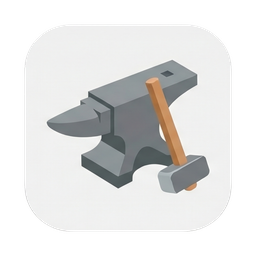
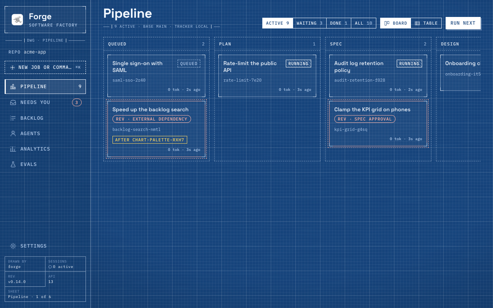
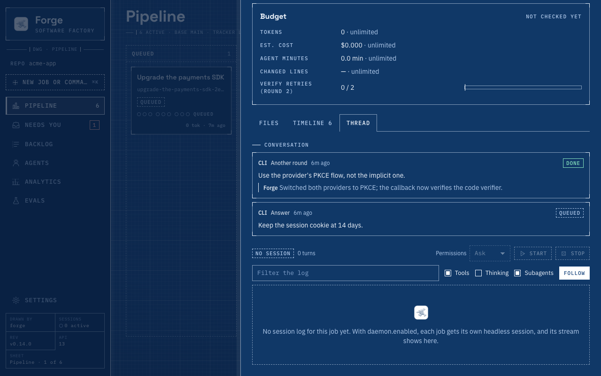
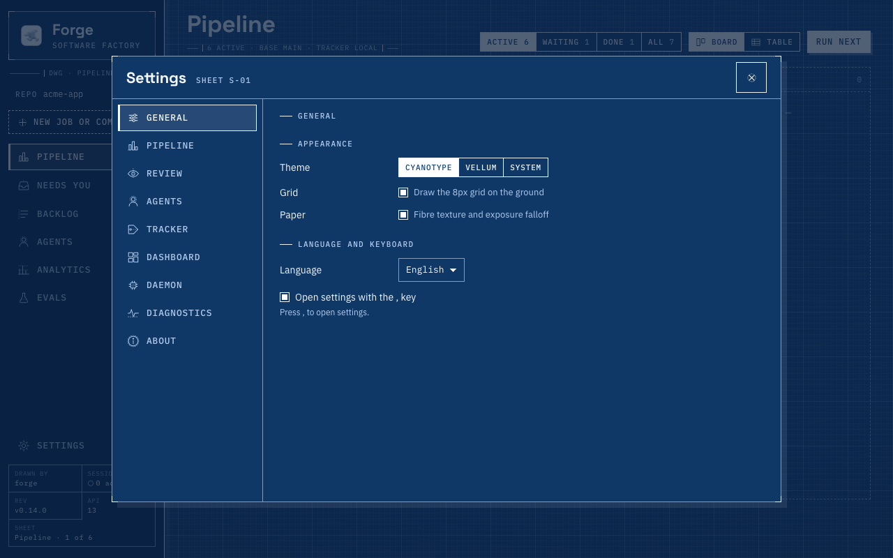

<p align="center">
  
</p>

<h1 align="center">Forge</h1>

> Thus at the flaming forge of life<br>
> Our fortunes must be wrought;<br>
> Thus on its sounding anvil shaped<br>
> Each burning deed and thought!
>
> — Henry Wadsworth Longfellow, *The Village Blacksmith* (1840)

<p align="center">
  <a href="https://github.com/maxwellmattryan/forge/blob/main/CHANGELOG.md"></a>
  <a href="https://github.com/maxwellmattryan/forge/actions/workflows/ci.yml"></a>
  <a href="#install"></a>
  
  
  <a href="LICENSE"></a>
</p>

⚒️ **Forge** is a lightweight, self-improving **software factory** for AI coding agents. You hand it a feature, a bug or a backlog item. A team of agents plans it, specs it, builds it in its own git worktree, reviews it through the lenses your repo cares about, and opens a pull request, or stops and asks you when only a human can decide.

```
request ─► plan ─► spec ─► [design] ─► spec gate ─► build ─► verify ─► review panel ─► integrate ─► decide ─► PR
                                          (you)        ▲        │          │ CHANGES                  │ESCALATE│
                                                       └────────┴──────────┘                          ▼        ▼
                                                                                                    (you)  sync: merged / feedback /
                                                                                                           conflicts / CI → continue
```

It ships as a **Claude Code plugin** (an orchestrator skill + 11 agents + a zero-dependency Node CLI + a live dashboard) and works in any repository: each repo only carries a small `.forge/` folder.

- 🔀 **Parallel by default.** Every job gets its own worktree and branch, a dev-server port, and (for Rust) a shared Cargo build dir. Run several jobs from one session or many. Job claims with heartbeats stop sessions from colliding.
- 🔁 **PR-aware across sessions.** `forge sync` reconciles every job with GitHub: merged, closed, behind base, conflicting, CI failing, new review threads. A PR that falls behind, or conflicts under `pr.conflicts: fix`, goes straight to the integrator. `/forge continue #123` picks up any PR, including ones a human started.
- 🗂️ **Your tracker, your way.** A local `backlog.md`, GitHub Issues (with optional label and/or GitHub Projects status sync that reads `.github/project-config.yml`), or your own adapter in `.forge/trackers/<name>.mjs` (or `.ts`).
- 🔍 **A review panel you choose.** Twelve built-in lenses (code, tests, security, design, ui, ux, accessibility, performance, realtime, infra, api, docs), repo-specific checklists, and a severity policy (`blockOn`) that decides what forces another round.
- 🙋 **Humans at the right moments.** Spec approval, split proposals (one issue is one PR unless you approve a split), questions, escalations, infra runbooks, merge conflicts, budget overruns and a likely secret the scanner caught stop the job and land in the dashboard's *Needs you* popover.
- ✍️ **You're the author.** Nothing Forge produces credits an AI: no co-author trailers, no "Generated with" footers, no session links in commits, PRs, issues or comments. See [Authorship](#authorship).
- 📈 **Measured and self-improving.** Per-agent and per-job token usage with API-equivalent cost, Forge metrics comparable across repos, eval suites (including replays of your own merged PRs), and retros that propose improvements as reviewed PRs, each logged as an experiment with a baseline.

## Install

In Claude Code:
```
/plugin marketplace add maxwellmattryan/forge
/plugin install forge@forge
```
Requirements: Node ≥ 22.18, git ≥ 2.38, and the GitHub CLI (`gh` ≥ 2.40) for PR and GitHub-tracker features. Supported platforms: [docs/SUPPORT.md](docs/SUPPORT.md).
On Node older than 22.18 the CLI fails at import and the attribution hook cannot load: it exits 1, which Claude Code does not treat as a block, so `aiAttribution: forbid` is not enforced.

The CLI also works on its own (for other agent runtimes, scripts or CI):
```bash
git clone https://github.com/maxwellmattryan/forge && cd forge && npm link
forge help
```
Forge's engine is TypeScript that Node runs directly, and Node does not strip types under `node_modules`, so install from a clone, not as a global npm package.

### Updating

Run `forge update` in a terminal or `/forge update` in Claude Code. It updates the install that is running. For a plugin install it runs `claude plugin marketplace update <marketplace>` and then `claude plugin update forge@<marketplace>`. For a clone it runs `git pull --ff-only`, and refuses when the checkout has uncommitted changes, a detached HEAD or no upstream. It prints the old and new versions, restarts the current repo's running dashboard on the new code, and lists what still needs a restart: a new Claude Code session for a plugin install, and dashboards in other repos. `forge update --check` only shows what it would run. `--keep-dash` leaves this repo's dashboard alone. Nothing is built or installed, because `dashboard/dist/` is committed and Forge has no runtime dependencies.

## Start

```
/forge init                      # detects your stack, asks a few questions, writes .forge/config.yml
/forge dash                      # opens the dashboard (http://127.0.0.1:7400)
/forge Add a reading-time badge to blog posts
/forge next 3                    # take the next three ready backlog items, in parallel
```
Commit the `.forge/` folder; runtime state inside it is gitignored.

The skill can be invoked as `/forge` or, fully qualified, `/forge:forge`.

## Commands

| | |
|---|---|
| `/forge <feature>` | new job from free text |
| `/forge next [n]` · `/forge issue <ref>` | take work: `next` first resumes a queued job nobody drives, else triages and starts the next ready tracker item |
| `/forge triage [n]` | readiness triage: mark ready items that lack an outcome, acceptance criteria, a bounded scope or are duplicates as needs-info, with one templated comment, so `next` skips them ([details](docs/TRACKERS.md#readiness-triage)) |
| `/forge continue <job \| #pr \| ref> [note]` | resume a job or PR: sync, integrate, address review feedback or CI |
| `/forge approve <job>` · `revise <job> <note>` · `answer <job> <text>` · `rework <job> <note>` · `cancel <job>` | human decisions |
| `/forge status` · `sync` · `dash` · `doctor` · `requests` · `update` | operate |
| `/forge retro` · `/forge eval …` | improve and measure |

The `forge` CLI underneath is also for scripts, CI and other agent runtimes: `forge help <command>` prints a command's flags and exit codes, and [docs/CLI.md](docs/CLI.md) covers `--json`, exit and error codes, environment variables and what stays stable. The commands worth knowing by hand:

<!-- forge:commands:start (generated from lib/commands/*.ts by npm run docs:commands; edit those tables) -->
| Command | What it does |
|---|---|
| `forge job link <id> <ref>\|--create\|--none [--reason R]\|--suggest` | link a job to an issue, create one, or record that it needs none (see [Linking jobs to issues](docs/TRACKERS.md#linking-jobs-to-issues)) |
| `forge job effort <id> low\|medium\|high\|xhigh\|max \| --inherit` | set a job's reasoning effort (forge job new --effort sets it at creation), or clear it so the job inherits runtime.effort; daemon sessions start with --effort and every agent gets it (see [Effort](docs/CONFIG.md#effort)) |
| `forge job step <id> [--session S]` | the job's next action (`spawn` with a ready agent brief, `run`, `wait`, `procedure` or `done`); read-only, the same state always gives the same answer, except that `--session <owner>` refreshes that session's claim heartbeat |
| `forge job advance <id> --session S [--max N]` | runs step's `run` actions in-process (at most N, default 20) and returns the next `spawn`, `wait`, `procedure` or `done` with `ran`, one line per command it ran; refuses (exit 3) a job session S does not hold, and stops at the first failed command (exit 1) |
| `forge secrets scan [<id> \| --paths <globs>]` | report likely credentials, masked with their fingerprints: a job's commits, commit messages, net diff, staged changes and PR title and body, or the main checkout's tracked files matching the globs; prints text (--json for the full result) |
| `forge git add <id> -- <path>...` | stage paths in the job's worktree, from any cwd; refuses git options and paths outside the worktree |
| `forge git commit <id> (--message T \| --message-file F) [-- <path>...]` | commit in the job's worktree, on its branch, from any cwd (how agents commit, in a daemon session too); refuses git options, paths outside the worktree, AI attribution and a likely secret (in the message always; in the staged changes under verifySecrets: block) |
| `forge tracker search <query> [--limit N] [--job <id>]` | search the tracker (see [Linking jobs to issues](docs/TRACKERS.md#linking-jobs-to-issues)) |
| `forge tracker triage [--limit N] [--all] \| --apply <batch>` | readiness triage: write a batch of ready and needs-info items for the forge:triage agent, then apply its verdicts (a templated comment and the needs-info mark, or the mark cleared) (see [Readiness triage](docs/TRACKERS.md#readiness-triage)) |
| `forge daemon status` | the daemon's sessions, from the terminal |
| `forge daemon log <job>\|--inbox\|--office [--lines N] [--follow]` | a session's log, from the terminal |
| `forge config get [<key>]` | read the effective config: one dotted key (strings raw, null when absent), or all of it (see [Changing settings](docs/CONFIG.md#changing-settings)) |
| `forge config set <key> <value>` | change one editable key in `.forge/config.yml`, keeping its comments (see [Changing settings](docs/CONFIG.md#changing-settings)) |
| `forge update [--check] [--keep-dash]` | update this Forge install (plugin or clone) and restart this repo's dashboard on the new code (see [Updating](README.md#updating)) |
<!-- forge:commands:end -->

## How it works

- **The orchestrator** (the `forge` skill) runs a short loop: `forge job advance <id> --session <its session>` (which keeps its claim alive) runs the bookkeeping commands step builds itself and returns the next action that needs judgement, the orchestrator does it (spawn the named agent with the brief step rendered, or wait), records the agent with `forge job agent … end`, and advances again. `forge job step` is the read-only view of the same decision. The CLI decides each step from recorded state, the same way it is the only writer of that state, so the pipeline's rules are tested code rather than prose. The orchestrator reads JSON and one-line agent replies, never code or full reviews, so it can drive many jobs without filling its context.
- **Agents** (`agents/*.md`) each own one step and one output file: planner → `plan.md`, spec-writer → `spec.md`, designer → `design.md`/`mockup.html`, builder → commits + `tasks.md` + `build.md`, reviewer → `review/round-N/<lens>.md` (and `review/integration/code.md` after a resolved conflict, judged by `forge job verdicts --round integration`), approver → `decision.md` + `pr.md`, integrator → merge resolution, retro → improvement proposals, judge → eval scores, triage → readiness verdicts for tracker items. They get their context from files, so any session can resume any job.
- **The CLI** (`forge`) owns the deterministic parts: state transitions, worktrees, ports, running and logging commands, the verify gate (with a test-integrity report), scope checks (files changed vs the spec's Approach), AC coverage (`forge job acs`: spec ACs vs the builder's proof table), finding counts (`forge job findings`: raised, fixed, disputed and recurring review findings), verdict policy, PRs, trackers, usage accounting, stats, evals and the dashboard server.
- **Committed build output merges itself.** With `worktrees.generated` set, `forge integrate` rebuilds conflicted generated files (the base side, then `worktrees.generatedBy`) instead of calling the integrator, which sees only real conflicts.
- **Merging waits for CI.** `forge pr merge` (used when `merge.auto: true`) syncs first, then merges directly only when checks pass or the repo has no CI workflows, refuses when they fail, and while checks are pending queues GitHub auto-merge only if branch protection will hold the PR; otherwise it defers and the next `forge sync` retries. Refused and failed merges exit 1. `--now` is a human override that bypasses CI and is logged as `pr-merge-bypass`; the orchestrator never uses it on its own.
- **1 job = 1 PR = 1 issue.** With a tracker in use, a job that didn't start from an issue gets one at spec approval: the same answer that approves the spec links one of the candidates Forge found, approves a new issue, or records that it needs none. A spec approved without one, or a job with no spec gate (`specApproval: never`), waits for that choice before build (see [Linking jobs to issues](docs/TRACKERS.md#linking-jobs-to-issues)).
- **State** lives in `.forge/jobs/<id>/` (gitignored) in the main checkout, shared by every worktree and session: `job.json`, an append-only `events.jsonl`, and the agents' markdown files.

Read more: [docs/ARCHITECTURE.md](docs/ARCHITECTURE.md) · [docs/CLI.md](docs/CLI.md) (the CLI's contract: `--json`, exit codes, environment variables) · [docs/CONFIG.md](docs/CONFIG.md) · [docs/TRACKERS.md](docs/TRACKERS.md) · [docs/IMPROVEMENT.md](docs/IMPROVEMENT.md) · [docs/PROTOCOL.md](docs/PROTOCOL.md) (running Forge on other agent runtimes)

## Dashboard

`forge dash` serves a single-page dashboard bound to localhost, drawn as a smithy at night: gunmetal plates cut at two corners, one silver-blue gleam where agents are at work, and one warm ember for what waits on you (the Forge theme here; Ash is the daylight one):







- **Status bar**: one slim row fixed at the bottom of every view. On the left, the **Foreman** first (always shown and accented as the supervisor above the pool: on, with a live dot while the office session works and a count of its permission prompts, or a dashed **Foreman off**), **Needs you** (a bell, with a count of the decisions waiting on you), the daemon (a plain `Daemon live/cap` count with a live dot while a session works; its state is in the tooltip) and its inbox (with the count of tool calls waiting for permission); in the middle, the facts (the Forge version, the API version, the live sessions and which view of the five you are on, dropping from the right when the room runs short); on the right, the model the builder runs on and whether the dashboard is connected to `forge dash`. Each indicator opens a popover with its details and controls: the Foreman's live thread at chat size under **Foreman** (its permission prompts, then the office session log with its status, model, effort, Permissions, Start and Stop, filters and subagents; while it is off, how to turn it on in `.forge/config.yml`); a Foreman row that opens that popover, then Start and Stop and one row per session (the Inbox, then each job, which opens that job's log) under **Daemon**; the permission prompts and the inbox's live log (the **Inbox log** toggle) under **Inbox**; every role's and review lens's model under **Models** (read-only: change them in Settings › Agents); the API versions and **Retry now** under **Connection**. Escape, the close button or a click outside closes a popover.
- **Command bar** (Cmd-K or Ctrl-K focuses the sidebar's **New job or command** input at md and up, and a second press opens the palette; typing or pasting there opens it with your text; on a phone, the command button in the top strip): type a request in plain words to start a job (its title is derived from the text, or give one), or a command with completion: `next [n]`, `sync`, `retro`, `continue <job> [note]` (or `resume`), `approve|revise|rework|answer|cancel <job> [note]`, `issue <ref>`. A new job's card appears at once and its job panel opens on the Thread. A job's panel has **Command for this job**, which opens the bar scoped to that job: a *For <job>* chip, and that job's applicable commands listed first (Backspace in the empty input or the chip's remove button drops the scope; free text still starts a new job). The bar's backdrop is a light scrim, so the page or job panel behind it stays readable.
- **Job panel**: opening a job (a card, a row, a chip, the palette or a popover) slides its panel in from the right over the page, which a backdrop dims; the status bar stays visible and usable, and opening another job from one of its popovers switches the panel to that job. A click on the backdrop, Escape or its close button closes it. Drag the panel's left edge (or focus it and use the arrow keys, Shift for bigger steps, Home and End) to resize it, never over the sidebar; one width is kept in this browser for every job, and a double-click restores the default. On a phone the panel is full width. Its Thread and Log tint each message by its sender: Claude cool, the CLI and the supervisor neutral, Forge warm.
- **Needs you** (the bell in the status bar): every human gate (including **Human check**, a CLI check such as the secret scan that only a human can clear), with its document and one-click actions (for an issue to link, and on the spec approval of a job without one: the candidates Forge found, another ref, a new issue, or none). Jobs parked on unfinished dependencies are not gates: they are listed apart, with **Unblocked, resume**, and are neither marked as waiting on you nor counted in the badge. PRs awaiting review and queued requests are listed there too. An old `#/inbox` link opens the Pipeline with this popover.
- **Backlog**: your tracker's ready items, with their readiness from triage (Needs info and what is missing, or Ready); start one with a click.
- **Agents**: running agents, orchestrator sessions, and the roster with models and prompt hashes.
- **Analytics**: Forge metrics plus token and cost breakdowns by role and model.
- **Evals**: runs, side-by-side comparisons, and a Run eval button.
- **Settings** (the gear, or ⌘, on a Mac and Ctrl+, elsewhere, even from a text field): **General** holds this browser's preferences, never stored in `config.yml`: Theme (**Forge**, **Ash**, **Temper** (dark, in the heat colours of tempered steel), or **System**: Ash on a light OS, Forge on a dark one, live, and never Temper; a theme saved by an earlier version still loads, the dark ones as Forge and the light ones as Ash), **Grain** (the film grain on the ground and the plates; the dark corners stay), plus language. The dashboard also honours your OS's reduced-motion setting: nothing slides or fades, the live dot's halo does not pulse, and a running step's ring stays still. The rest of Settings is the editable `.forge/config.yml` keys as forms saved through `forge config set`'s write path, `forge doctor` diagnostics with a copyable report, and the versions Forge is running. Settings are locked while the daemon runs, because any change to `config.yml` stops it.

The dashboard is a Svelte 5 + TypeScript single-page app. Its built output (`dashboard/dist/`) is committed, so installing the plugin builds and installs nothing.

Each running agent shows on its job's card, in the drawer header and on the Agents page as one live line: its role, model, how long it has run and the last thing its Claude Code transcript shows (a tool call or a line of text), beside the owning session's liveness. The drawer's **Agents** tab lists the round's agents with their status, duration and tokens, and follows the chosen one's transcript live; a job driven from an interactive session (not the daemon) shows that session's transcript, read-only, in its Log tab. Transcripts are read from `$CLAUDE_CONFIG_DIR/projects`, else `~/.claude/projects`, and only for this repo's own sessions.

Buttons don't run agents directly. They queue requests, and an orchestrator session drains them: your own (`/forge requests`), so permissions and spend stay with you, or, with `daemon.enabled: true`, a headless Claude Code session that `forge dash` supervises and nudges whenever new requests arrive. With the daemon, each job gets its own headless session (up to `daemon.maxConcurrent` at once), and a small inbox session takes requests that have no job yet, so one job's crash never stalls another and each job has a log of its own. The daemon spends tokens unattended, limited to the tools in `daemon.allowedTools`. When an agent needs anything else, its session pauses and the call shows in the status bar's Inbox popover and in the job drawer's dock with Allow once, Allow for this session and Deny, so you grant it from the dashboard instead of editing config. Each session's log also has a **Permissions** selector (Ask, Auto, Refuse) that switches that one session's Claude Code permission mode, live, until `forge dash` restarts; see [Daemon](docs/CONFIG.md#daemon). A job's log also has an **Effort** selector (Inherit, Low to Max) that sets the job's reasoning effort, for its agents at once and its session from its next start, whether or not the daemon runs; a job whose effort differs from `runtime.effort` shows it as a chip on its card; see [Effort](docs/CONFIG.md#effort). When it is in use, the status bar's **Daemon** and **Inbox** indicators summarise the pool (with `foreman.enabled`, the **Foreman** indicator before them opens the office session's live thread), and their popovers hold the rest: its status, `live/cap` job sessions, Start and Stop, a row per session with its state (held on budget, waiting for a slot, kept by running agents and so on) that opens a job's log, the inbox's live log (the **Inbox log** toggle, in the Inbox popover), and every pending permission prompt. `forge daemon status` and `forge daemon log <job> --follow` show the same from a terminal.

## Authorship

Forge treats the human who runs it as the author of everything it produces. This is enforced in three layers:

1. **Prompts**: the orchestrator and every agent that writes commits or GitHub text are told never to add AI attribution.
2. **A hook**: while the plugin is enabled, a `PreToolUse` hook inspects every `git commit/tag/merge`, `gh pr/issue/release/api` and `glab` command (including `-F`/`--body-file` files) and blocks it if it carries an AI co-author trailer, a "Generated with …" footer, a robot-emoji signature or a session link. It runs for subagents too. Mentions such as "parse Claude Code transcripts" pass; only signatures are blocked.
3. **The CLI**: before `forge pr open` pushes, it rewrites any branch commit message that still carries attribution (content and authorship untouched), and it strips attribution from PR bodies, issues and tracker comments.

Claude Code adds its own trailer and PR footer unless told not to, and a plugin isn't allowed to change that setting for you. To turn them off everywhere (not just in Forge), add this to `~/.claude/settings.json` (Claude Code ≥ 2.1.281):
```json
{ "attribution": false }
```
Opting out: `aiAttribution: allow` in a repo's `.forge/config.yml`, or `FORGE_AI_ATTRIBUTION=allow` in the environment.

## Project

- [Security policy](SECURITY.md): report vulnerabilities privately. Fixes go to the latest minor release ([supported versions](SECURITY.md#supported-versions)).
- [Contributing](CONTRIBUTING.md): development setup and the local dev flow (`npm run dev`, `npm run dev:claude`), the verify list and pull-request conventions.
- [Code of Conduct](CODE_OF_CONDUCT.md): Contributor Covenant 2.1.

## License

MIT · Strike while the iron is hot. 🔥
